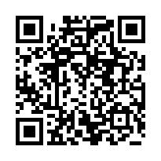

<!-- Copyright (C) 2026 rezky_nightky -->
<!-- SPDX-License-Identifier: GPL-3.0-only -->

# zylaxion Commercial License

zylaxion is dual-licensed:

- **GPL-3.0-only** for open-source use (see [LICENSE](LICENSE)).
- **Commercial License** for proprietary and commercial use (this document).

If your use of zylaxion can satisfy the copyleft obligations of the
GPL-3.0-only — including releasing your modifications, integrations, and
the corresponding source code to anyone you distribute to — you do not
need to pay anything. The GPL path is complete, free, and first-class;
it is not a trial. The Commercial License exists for the uses GPL
cannot honestly cover: keeping your modifications proprietary,
embedding zylaxion in a closed product, or redistributing it under
different terms.

---

## 1. Who Needs a Commercial License

You need a Commercial License if any of the following describe your use:

- **Production use at a company** — running zylaxion on commercial
  workstations, kiosks, demo units, or developer fleets, where the GPL's
  copyleft obligations (open-sourcing your modifications and
  integrations) cannot or will not be met.
- **Product embedding** — shipping zylaxion (or a derivative of its
  synthesis engine) inside a closed hardware or software product,
  appliance, or image.
- **SaaS and content offerings** — providing a hosted or packaged
  experience whose value depends on zylaxion, where you would otherwise
  be obligated to release your service's zylaxion-related source code.
- **Redistribution under different terms** — distributing zylaxion (or a
  derivative) under terms other than GPL-3.0-only.
- **Any use that cannot meet GPL-3.0 copyleft obligations** — when in
  doubt about whether your use complies, that doubt is the signal to
  either study [LICENSE](LICENSE) carefully or buy the license that
  removes the question.

## 2. Who Does NOT Need One

The following uses are fully covered by GPL-3.0-only and cost nothing:

- **Personal use** — keyboard sound on your own machines.
- **Hobby projects** — experiments, home labs, self-hosted setups,
  stream setups you do not sell.
- **Non-commercial research** — academic study, benchmarking,
  measurement, and publication of results.
- **Education** — teaching, coursework, and learning.
- **Open-source contributions back to upstream** — forking, fixing,
  extending, and opening PRs against this repository. The
  [trademark policy](TRADEMARK.md) governs the Marks, not this
  license; contribution forks keep the name unchanged and are welcome
  without permission or payment.

## 3. Pricing

Prices are pegged to USD, payable in cryptocurrency (see
[Payment](#7-payment) below). Tiers are self-declared by the buyer in
good faith — pick the tier that honestly matches your situation; nobody
audits you, but misrepresenting revenue to underpay is a breach of the
license terms.

| Tier       | Price          | Target                                                       |
| ---------- | -------------- | ------------------------------------------------------------ |
| Personal   | Free (GPL-3.0) | Hobby, personal, non-commercial, open-source contributions   |
| Individual | $99/year       | Solo devs, freelancers, revenue < $100K/year                 |
| Business   | $2,199/year    | Individual businesses and small teams (SMB)                  |
| Company    | $29,999/year   | Companies and enterprise, OR any redistribution rights       |

Notes:

- **Revenue thresholds** refer to your total annual revenue (company or
  individual, whichever applies), not your zylaxion-specific revenue.
- **Multi-year discount** (owner discretion): 20% off a 2-year term,
  30% off a 3-year term.
- **The ladder climbs with the work.** zylaxion's value increases
  year by year; the owner re-prices the business end of
  the ladder as the project compounds. Grandfathering is the standing
  rule: buyers who paid before any move keep the price they paid, for
  the term they bought. The business end moves with the work: Business
  $2,199/year and Company $29,999/year are the owner's pricing call for
  zylaxion (night-improve-17) — Personal stays free and Individual
  holds at $99/year. Existing Company-tier customers at $9,199 keep
  their purchased price for their purchased term; new Company licenses
  follow the current table ($29,999).
- **Redistribution rights** are granted at the Company tier only.
  Trademark licensing is separate — see
  [TRADEMARK.md](TRADEMARK.md).
- No free tier above Personal is granted without explicit owner
  approval.

### Unauthorized Use

zylaxion's code is open to read, learn from, and build on — under
GPL-3.0-only's honest terms, or under a paid Commercial License.
What is NOT open is taking it: stealing the code, forking it
illegally, stripping or ignoring the license, or shipping it
inside a closed-source commercial product — whether done by a
company or by an individual — without contacting the owner
(rezky_nightky / oxyzenQ,
[with.rezky@gmail.com](mailto:with.rezky@gmail.com)) and paying
for the license first. That is not a loophole, a gray area, or a
clever business move. It is theft of one person's years of work,
a breach of GPL-3.0-only and of this Commercial License, and —
in the owner's own words — the mark of the worst kind of human:
a rotten one. If closed source is what you need, the Company
tier exists precisely for that; buy it. If you cannot or will
not pay, the GPL path is complete and free — open-source what
you build. There is no third path that leaves you clean.

## 4. What You're Actually Licensing

The Company tier licenses the technology stack, not just the keyboard
sound binary. The five assets below are what that license actually
covers — each one is verifiable from this tree, not from a pitch:

1. **The eBPF input tap architecture** — passive kernel-side capture
   with zero device grab, hotplug-safe and suspend-safe.
2. **The daemonless control plane** — pinned BPF maps as state store,
   attach-once, unprivileged-verb pattern.
3. **The Zactrix Engine** — time-variant spectral envelope synthesis,
   LTS-frozen with six proofs
   ([docs/ZACTRIX_LTS.md](docs/ZACTRIX_LTS.md)) and full security
   audit ([docs/ZACTRIX_SECURITY.md](docs/ZACTRIX_SECURITY.md)).
4. **Zero-sample DSP architecture** — no audio decoder, no wavetable,
   no sample asset (the ELF `DT_NEEDED` sweep proves it).
5. **The micro-randomization and sample-rate-honest laws** — the
   `c^(R/S)` renormalization and per-keystroke jitter algorithms.

If you want to adopt, adapt, or integrate any of these into your own
product (closed-source, proprietary, or SaaS), the Company tier gives
you the license. If you want to build from source under GPL-3.0-only,
the Personal tier is free. This is technology licensing, not a
keyboard-sound subscription. The $29,999/year Company tier is priced
against the cost of replicating the architecture in-house (an
estimated 6-12 months of R&D), not against consumer keyboard sound
products.

The Company tier is not priced for a keyboard sound binary. It
licenses the embeddable DSP architecture — the eBPF input tap, the
daemonless control plane, the Zactrix Engine (LTS-frozen with six
proofs), the zero-sample DSP discipline, and the micro-randomization
law — for adaptation into embedded devices, game engines,
accessibility tools, and hardware keyboards. See "Use Cases Beyond
Keyboard Sound" (section 5 below, mirrored in the README). The
Company price reflects the architectural surface, not the
proof-of-concept application.

## 5. Use Cases Beyond Keyboard Sound

The same stack serves problems beyond the desktop keyboard. The tap,
the control plane, the engine, and the zero-sample law are separable
assets, and each use case below adapts one or more of them:

- **Accessibility tools** — auditory feedback for visually impaired
  users, adaptive input devices.
- **Remote desktop / VDI** — input capture without daemon overhead.
- **Embedded devices** — zero-sample audio feedback for kiosks, ATMs,
  medical devices with storage constraints.
- **Game engines** — input sound module without audio assets.
- **Security / observability tools** — kernel-side input capture for
  auditing, parental control, or compliance.
- **Hardware keyboards** — built-in synthesis in firmware.

The Company license covers adaptation into any of these contexts. The
architecture is the asset; the keyboard sound is the proof of concept.

## 6. What Each Tier Grants

Every paid tier grants, for the license term:

- **Use without GPL copyleft** — the right to use, modify, and integrate
  zylaxion in your products and infrastructure without the obligation to
  open-source your modifications.
- **Priority support** — your licensing and integration questions are
  answered ahead of the free queue.
- **Internal modification rights** — private forks and patches for your
  own use, with no disclosure requirement.

The **Company** tier additionally grants:

- **Redistribution rights** — the right to distribute zylaxion (or your
  derivative of it) as part of your own offering, under your own terms,
  to your customers. This is the only tier that carries it.
- Rebranding and redistribution of the Marks still requires separate
  trademark permission — see [TRADEMARK.md](TRADEMARK.md).

## 7. Payment

Payment is **USD-pegged, paid in crypto**: send the cryptocurrency
equivalent of the USD price at purchase time. The exchange rate is
taken from CoinGecko or CoinMarketCap at the moment of the transaction
agreement. These are owner-verified receive addresses — the same
addresses that passed offline cryptographic verification described in
the [zelynic README](https://github.com/oxyzenQ/zelynic#crypto-donations)
(EIP-55 mixed-case checksum for Ethereum, bech32m witness-v1 for
Taproot, base58-to-32-byte ed25519 key for Solana).

**Always double-check the address on screen before sending.** Network
mismatches — for example, sending USDT-ERC20 to a Solana address, or
BTC to a non-Taproot address — permanently lose funds.

### Solana (SOL / USDT-SPL)

```text
88umzS7abaToaGQVgTVXt5SnuvcjTw2jPSM6Ha2JYmXM
```



### Ethereum (ETH / USDT-ERC20 / USDC-ERC20)

```text
0x1bCbA21c07B5636a942De27AA7Ee8283cEDb4C3D
```


### Bitcoin (BTC, Taproot P2TR)

```text
bc1p88nqysn4p8u9zxwz2pyxs5pl77wllcrk6ca2r2l3ryr3863hxkys5vdkze
```


These addresses double as the project's voluntary donation addresses;
commercial payments are distinguished by the licensing inquiry that
accompanies them, not by a different address.

## 8. Verification Process

1. **Send a licensing inquiry** to [with.rezky@gmail.com](mailto:with.rezky@gmail.com)
   (or open a GitHub issue at [@oxyzenQ](https://github.com/oxyzenQ))
   naming your chosen tier and term.
2. **Pay** the USD-pegged amount in crypto to the address above for
   your chosen network.
3. **Submit the transaction hash** by replying to the inquiry thread.
4. **Owner verifies the transaction on-chain** — amount, address, and
   confirmations.
5. **License PDF issued within 48 hours** of verification, sent to
   your inquiry email.

The license PDF names the licensee, the tier, the term, and the grant
scope. Keep it; it is the proof of your commercial rights.

## 9. Contact

- **Licensing email**: [with.rezky@gmail.com](mailto:with.rezky@gmail.com)
- **GitHub**: [@oxyzenQ](https://github.com/oxyzenQ)

For trademark matters, see [TRADEMARK.md](TRADEMARK.md) — commercial
licensing and trademark licensing are separate.

<!-- ZYLAXION-DISCLAIMER -->
<!--
  Documentation Disclaimer — read before relying on any data point.

  This document may contain stale data, hardcoded counts, or outdated
  file paths and symbol names. Maintainers update source code but may
  forget to sync every doc — perfect sync across every .md file is a
  known maintenance burden with diminishing returns.

  Source code (`src/**/*.rs`) is the single source of
  truth. Always cross-check against the actual source files before
  relying on any specific number (preset count, rate bound, LOC),
  file path, function name, or config key.

  If you find a discrepancy, please open a PR — the doc is wrong, not
  the source.
-->
