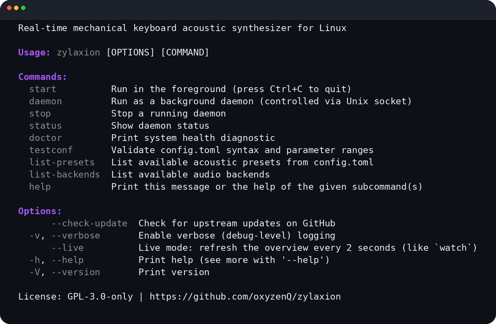

<!-- Copyright (C) 2026 rezky_nightky -->
<!-- SPDX-License-Identifier: GPL-3.0-only -->

<p align="center">
  
</p>

<h1 align="center">zylaxion</h1>

<p align="center">
  <strong>Linux-first real-time mechanical keyboard acoustic engine.</strong>
</p>

<p align="center">
  Pure procedural synthesis. Zero audio samples. Low-latency.
</p>

<p align="center">
  <a href="https://ko-fi.com/rezky">
    
  </a>
</p>

## Demo

<!-- Screenshot asset: the rendered help is the real `zylaxion -h` output
     of the v11 build with the brand-styled CLI (purple headings, grey
     grammar tier — night-improve-2). The help surface touches no audio
     or input hardware, so a capture host renders it byte-identical to
     a desktop. A typing-sound video demo needs real audio hardware, so
     it follows at the next owner-host capture session. -->

<p align="center">
  
</p>

---

zylaxion transforms every keystroke into a spatially accurate mechanical keyboard sound using Linux's `evdev` interface and real-time audio output through `cpal` and PipeWire.

Instead of replaying recorded samples, every sound is **synthesized mathematically** using noise excitation, TPT State Variable Filters, resonance modeling, and exponential decay envelopes. This pure procedural approach means:

- **Zero audio samples** — no wavetables, no recorded clips, no sample libraries. The entire sound engine is mathematical computation.
- **Ultra-lightweight** — the binary is self-contained; no audio assets, no config files, nothing to load, store, or manage.
- **24 hand-tuned presets compiled in** — filter frequencies, resonance Q, decay coefficients, spring mix: every value is validated Rust data baked into the binary at build time.
- **Micro-randomized** — every keypress gets a unique noise seed, ±1.5% pitch
  drift, ±5% amplitude drift, ±3% stereo pan jitter, and inter-keystroke
  timing variation. The same key never sounds identical twice — just like a
  real physical keyboard. No audio samples are replayed.

No audio files. No sample libraries. No wavetable playback. Just math.

**Works on Wayland, X11, and Linux TTY.**

## Features

- **Pure procedural synthesis** — all sounds generated from math, not samples.
  Three-layer TPT SVF engine models the click transient, spring resonance,
  and housing "thock" of real mechanical key switches with zero audio assets.
- **Real-time audio** — cpal + PipeWire with interrupt-driven ring buffer
  rendering. Typical latency under 3 ms.
- **Polyphonic voice pool** — 16 simultaneous voices with oldest-first voice
  stealing, stereo panning based on key position, per-keypress pan jitter,
  two-stage decay envelope (fast transient + slow tail), and a ~2 ms soft
  release ramp that eliminates the "click off" artifact on key-up.
- **Compiled preset registry** — 24 acoustic presets are compile-time
  data inside the binary: type-checked Rust, proven in-range by the
  test tree, zero parse errors possible, zero I/O at startup. Select
  with `--preset <name>` or the `ZYLAXION_PRESET` environment
  variable; tune loudness with `ZYLAXION_VOLUME`. No config file, no
  watcher thread, no validation subcommand — a sound switcher does
  not need them (night-improve-22).
- **Kernel-side eBPF tap, zero daemons** (night-improve-23) — the input
  tap is a passive kernel-side probe on the exported input_event()
  function, attached through a three-step chain the loader walks on
  its own (fentry when vmlinux BTF is present, then kprobe on
  input_event, then kprobe on input_handle_event); the
  state store is pinned BPF maps on bpffs, and the player is a
  stateless process that owns nothing: no PID file, no Unix socket, no
  IPC protocol, no flock, no supervision. `sudo zylaxion attach` once
  per boot, then every verb is unprivileged and instant.
- **Passive tap, zero interference** — no `/dev/input` access, no evdev
  grab, no udev rules, no `input` group membership. Device hotplug,
  suspend/resume, and other input consumers (libinput, the compositor)
  are untouched by construction.
- **Kernel-side typing telemetry** — the tap accumulates per-key
  counters in the kernel at zero userspace cost; `zylaxion status
  --verbose` renders them (a feature no userspace sound tool can
  offer for free).
- **Zero system dependencies** — only requires a C compiler for linking.
  Audio via PipeWire/PulseAudio (system); the input half lives in the
  kernel.
- **Linux-first** — built for the Linux kernel (5.15 minimum, verified
  by `zylaxion doctor`: "verified supported" / "verified unsupported").
  No X11 or Wayland dependency; the tap works everywhere the kernel
  does.

## Installation

### From source

Requires: Rust toolchain ([rustup.rs](https://rustup.rs/)),
`pkg-config`, `libasound2-dev`. (The libinput/libudev headers died with
the libinput capture in night-improve-23 — the tap needs none of them;
the eBPF object ships embedded in the binary.)

> zylaxion plays audio through `cpal`, which talks to PipeWire /
> PulseAudio / ALSA via the OS's default audio bridge. No PipeWire
> native development headers are required — only `libasound2-dev`
> (ALSA backend that cpal links against).

```bash
git clone https://github.com/oxyzenQ/zylaxion.git
cd zylaxion

# One command, no flags: detect the CPU level (amd64 v3/v4), build the
# matching shape, install to /usr/bin/ + the boot oneshot
./install-on-my-machine.sh
```

The fast lane detects the CPU's x86-64 microarchitecture level
(x86-64-v4 when the full AVX-512 set is present, x86-64-v3 for the
AVX2/FMA/BMI class, baseline otherwise) and builds through the
parity-checked cargo aliases, so the installed binary is the same
optimization tier the release pipeline ships. It installs the binary
to `/usr/bin/zylaxion` and the **boot oneshot**
(`/etc/systemd/system/zylaxion-attach.service`) that plants the
kernel-side tap at every boot. It is a `Type=oneshot` unit, not a
daemon: it runs `zylaxion attach`, exits, and stays dead — what
remains resident is the kernel side only (one passive BPF program
plus pinned maps, zero processes).

The portable package lane builds the plain baseline shape and lands
the same system destinations — no CPU tuning, no flags:

```bash
./scripts/package/install.sh
```

> **Note:** no `input` group, no udev rules — the tap is a passive
> kernel-side probe, and the attach hands the pins to your user so every
> other verb stays unprivileged.

### Download a release binary

Pre-built binaries are attached to each [GitHub release](https://github.com/oxyzenQ/zylaxion/releases).
Download, make executable, and copy to a directory on your PATH:

```bash
wget https://github.com/oxyzenQ/zylaxion/releases/latest/download/zylaxion
chmod +x zylaxion
sudo install -Dm755 zylaxion /usr/bin/zylaxion
```

### Release Verification

Each release ships **three** checksums: classical SHA-512 + quantum-resistant
BLAKE2b-512 + SHAKE256. Full instructions in
[docs/VERIFY_RELEASE.md](docs/VERIFY_RELEASE.md).

```bash
# Classical (universal)
sha512sum -c zylaxion-vX.Y.Z-linux-amd64-gnu.tar.gz.sha512sum

# Quantum-resistant — BLAKE2b (fastest, in coreutils)
b2sum -c zylaxion-vX.Y.Z-linux-amd64-gnu.tar.gz.b2sum

# Quantum-resistant — SHAKE256 (NIST PQ standard, via Python)
# openssl's -shake256 default output length varies; Python is consistent
COMPUTED=$(python3 -c "import hashlib; print(hashlib.shake_256(open('zylaxion-vX.Y.Z-linux-amd64-gnu.tar.gz','rb').read()).hexdigest(64))")
EXPECTED=$(awk '{print $1}' zylaxion-vX.Y.Z-linux-amd64-gnu.tar.gz.shake256)
[ "$COMPUTED" = "$EXPECTED" ] && echo "OK" || echo "FAILED"
```

## Usage

```
sudo zylaxion attach             # Plant the kernel-side tap (once per boot)
zylaxion on                      # Sound on (spawns the stateless player)
zylaxion on --preset cherryMX    # Sound on with a compiled-registry preset
zylaxion preset --switch topre    # Switch the preset live while playing
zylaxion volume --percent 60     # Retune the master volume live
zylaxion off                     # Sound off (player self-exits, zero processes)
zylaxion status                  # Kernel verdict, tap residency, player state
zylaxion status --verbose        # + kernel-side typing telemetry (static, print once)
sudo zylaxion detach             # Unpin everything — nothing left in the kernel
zylaxion                         # Quick status overview
zylaxion doctor                  # System health diagnostic (kernel verdict included)
zylaxion list-presets            # List the 24 compiled presets + active one
zylaxion list-backends           # Show available audio backends
zylaxion --check-update          # Check for latest GitHub release
zylaxion -V                      # Show version + build info
```

The hidden and advanced vocabulary — the short aliases (`-s`, `-p`,
`-v`), the environment surface (`ZYLAXION_PRESET`, `ZYLAXION_VOLUME`,
`NO_COLOR`, `RUST_LOG`), and the internal `_play` verb — is
documented completely in the Pro mode section of `zylaxion --help`,
the one reference surface.

### Configuration

There is no configuration file — night-improve-22 deleted
`config.toml` and its whole support stack (search paths, TOML
parsing, the mtime watcher, the `testconf` validator). The owner's
verdict: a file format, a parser, and a background poller are absurd
maintenance weight for switching between 24 sounds. The masterclass
replacement is the Unix configuration surface itself:

1. `--preset <name>` on the CLI (highest priority)
2. `ZYLAXION_PRESET=<name>` in the environment (persistent selection —
   shell profile, systemd `Environment=`, wrapper script)
3. the compiled default preset (`technical`) if neither names one

The master output volume follows the same law:
`ZYLAXION_VOLUME=1.5` (headphones) overrides the compiled
laptop-speaker default of 5.5. An invalid value is a hard error —
there is no silent fallback, and an unknown preset name prints the
full catalog plus a did-you-mean tip.

A preset is chosen when the sound starts; while playing, switch it
live with `zylaxion preset --switch <name>` (one map write — the
player's watcher thread swaps the DSP model in place). For a sound
switcher that is the honest lifecycle — there is nothing to
hot-reload.

### Built-in sound presets

zylaxion ships with **24 presets** — 6 "character" presets, 3
switch-type presets, **10 high-fidelity legendary keyboard profiles**
(v4.0.0+) tuned to mimic real switches, and **5 sci-fi / futuristic
presets** (v4.1.0+) that don't mimic anything real. Since v4.2.0,
**every preset** uses a 3-layer DSP engine (click + spring + housing
"thock") for realistic acoustic body. Since v5.0.0, every keypress
applies **micro-randomization** (±1.5% pitch drift, ±5% amplitude
drift, unique noise seed) so the same key never sounds identical twice
— breaking the "uncanny valley" of deterministic synthesis.

#### Character presets (general use)

| Preset    | Description                                      |
|-----------|--------------------------------------------------|
| technical | Crisp, loud, punchy. Cherry MX Blue click style. **Compiled default.** |
| cherryMX  | Balanced reference. General MX Blue/Brown.       |
| classic   | Deeper, resonant. Warm bucklespring tone.        |
| studio    | Softer attack, longer decay. Office-friendly.     |
| elegant   | Very soft, muffled. Low-profile keyboards.       |
| whisper   | Extremely quiet, short decay. Libraries/meetings. |

Plus three switch-type presets: `linear`, `tactile`, `clicky`.

#### Legendary keyboard profiles (v4.0.0+)

Each of the following presets was hand-tuned against reference
recordings of the actual hardware. The DSP parameters (click
frequency, resonance Q, decay coefficient, ambient rattle) are
adjusted to capture the signature character of each switch. Three
presets (`ibm_model_m`, `topre`, `alps_skcm`) received a
realism tuning pass in v4.1.0 — softer Topre attack, longer IBM
Model M ring, deeper ALPS housing.

| Preset             | Switch Type         | Character                                              |
|--------------------|---------------------|--------------------------------------------------------|
| `ibm_model_m`      | Buckling spring     | Deep, very resonant, long ring. The showcase legend. |
| `topre`            | Electrocapacitive   | Deep "thock", smooth, low resonance. Realforce/HHKB.  |
| `cherry_mx_black`  | Linear (heavy)      | Smooth thud, faint spring ping. ~80g actuation.       |
| `cherry_mx_clear`  | Tactile (heavy)     | Pronounced bump, louder than Brown. ~65g actuation.   |
| `cherry_mx_silver` | Linear (low-pro)    | Fast, snappy bottom-out. Designed for gaming.         |
| `buckling_spring`  | Buckling spring     | Sharper & brighter than Model M. Think Model F.       |
| `alps_skcm`        | Tactile (vintage)   | Complicated ALPS — loud, hollow housing ring.         |
| `gateron_yellow`   | Linear (thocky)     | Lubed linear with PBT caps. Deep, rounded thock.      |
| `zealios_v2`       | Tactile (sharp)     | Almost clicky-feeling bump. Enthusiast tactile.       |
| `rotary_encoder`   | Encoder detent      | Not a keyboard — a smooth metallic knob click.        |

#### Sci-Fi / Futuristic presets (v4.1.0+)

These five presets are completely original acoustic signatures —
they don't mimic real keyboards. Each pushes the DSP parameter
ranges to extremes for cyberpunk aesthetic, gaming immersion, or
just fun. Perfect for streaming setups with a sci-fi theme, game
developers wanting UI key sounds, or anyone who wants a unique
typing experience no human has heard before.

| Preset             | Character                                                  |
|--------------------|------------------------------------------------------------|
| `cyber_deck`       | High-pitched metallic pings. Hollywood "future terminal".  |
| `oceanic`          | Deep underwater rumble, long bass sustain, muffled thud.   |
| `glass_tactile`    | Tapping a crystal wine glass — pure ringing tone.          |
| `retro_typewriter` | Sharp typebar strike + cast-iron frame ring (no bell).     |
| `neon_pulse`       | Cyberpunk UI button — heavy granular texture on a click.   |

Try them all:

```bash
zylaxion list-presets
zylaxion start --preset ibm_model_m
zylaxion start --preset topre
zylaxion start --preset alps_skcm
zylaxion start --preset glass_tactile
zylaxion start --preset neon_pulse
```

## Security & Privacy

zylaxion is designed with a **zero-leakage** posture. The short
version: **your keystrokes never leave the process.** The full
design philosophy behind that posture — "the boring and stealth" —
is codified in [docs/PHILOSOPHY.md](docs/PHILOSOPHY.md).

### What zylaxion reads

- **Hardware scancodes** — the physical key location on the keyboard
  (e.g. scancode `30` is the home row key under QWERTY's left hand).
  This is *not* an ASCII character. zylaxion does not translate
  scancodes into letters, symbols, or text. It feeds them straight
  into the DSP engine to choose a stereo pan position and trigger a
  click sound.
- The kernel's input core via a passive eBPF probe on the kernel's
  input_event() function — the same key events the kernel itself
  dispatches, observed passively (night-improve-23).

### What zylaxion does NOT do

- **Does not log scancodes** — not at `info`, not at `debug`, not at
  `trace`. The `KeyEvent` struct exists to drive the DSP engine, not
  for human inspection. Audit the codebase: `grep -r 'scancode'
  src/ | grep -E 'log::|println!|eprintln!'` returns zero hits
  in production paths.
- **Does not store keystrokes** — there is no on-disk log, no
  history file, no analytics. Nothing is written to any filesystem:
  the state store is pinned BPF maps on bpffs, and the per-key press
  counters in the stats map are aggregate counts (which keycode, how
  many times), never sequences — a frequency histogram cannot be
  replayed into typed text.
- **Does not transmit keystrokes** — no telemetry, no analytics, no
  crash reports. The only outbound network call is the explicit
  `zylaxion --check-update` subcommand, which fetches the latest
  GitHub release tag and exits. No background phone-home. Under
  root (`sudo`, `su`, a root shell) that check refuses with a
  "do not use sudo" error before any network I/O, and the player
  refuses root the same way — a root player would open audio in
  root's session, which no user desktop shares. `zylaxion doctor`
  warns when run as root because its verdicts describe root's
  session, not yours.
- **Does not accept inbound network connections** — there is no TCP
  listener, no HTTP server, no Unix socket, no IPC protocol. The
  control plane is pinned BPF maps on bpffs: the only writers are the
  attach process (root, once) and your own user's CLI verbs
  (bpffs file permissions govern access — the attach hands the pins
  to your user, so other users cannot touch your sound).

### Why this matters

A naive "acoustic keyboard" implementation that logged scancodes for
debugging would be a side-channel leak: malware with read access to
`journalctl --user -u zylaxion` could reconstruct typed passwords by
mapping scancodes back through the user's keyboard layout (QWERTY,
Dvorak, etc.). zylaxion's zero-trust logging policy eliminates this
attack surface — there is nothing in the logs to reconstruct.

### Verifying the policy yourself

```bash
# Should print zero matches in production paths (excluding examples/
# which carry an explicit --dump-scancodes opt-in for hardware
# debugging):
grep -rn 'scancode' src/ examples/ --include='*.rs' | \
    grep -E 'log::|println!|eprintln!' | \
    grep -v 'examples/'

# Introspect the entire control plane with stock kernel tooling:
bpftool map dump pinned /sys/fs/bpf/zylaxion/control
# The kernel IS the config, the config IS introspectable.
```

## Building

```bash
# Run all checks (fmt + clippy + test)
./scripts/build.sh --check-all

# The full gate-keepers run (permissions, headers, LOC caps, language,
# emoji sweep, pins health, release parity, name-case rule)
./scripts/gate-keepers.sh

# Build release binary
cargo build --release --locked

# Host-native build, tuned to this machine's CPU (own target dir,
# same optimization tier as the release package)
cargo pro-native-gnu

# The exact CI release shape (matches the release workflow verbatim)
cargo pro-linux-amd64-gnu

# Arch-baseline release shapes — bit-for-bit the optimization tier the
# release artifacts ship (x86-64-v3: AVX2-era CPUs; x86-64-v4:
# AVX-512-era). Each stamps its platform id into the binary's Build:
# line (self-report via zylaxion -V).
cargo pro-linux-amd64-v3-gnu
cargo pro-linux-amd64-v4-gnu

# Bump the package version
./scripts/dev/version-to.sh v11.0.1
```

### Release artifacts

Release tags ship one tarball per platform at
[Releases](https://github.com/oxyzenQ/zylaxion/releases), each with
three checksums (SHA-512, BLAKE2b-512, and the quantum-resistant
SHAKE256) and — when the owner's signing key is configured — a GPG
detached signature (`.asc`):

- `zylaxion-v<version>-linux-amd64-v3-gnu.tar.gz` — x86-64-v3 baseline,
  dynamic glibc
- `zylaxion-v<version>-linux-amd64-v4-gnu.tar.gz` — x86-64-v4 baseline,
  dynamic glibc

Pick v3 when in doubt: every CPU that runs v4 runs v3. The musl lane
is documented dormant (the alsa C library — cpal's backend — has no
static musl answer yet; the evidence and the unlock paths live in the
release workflow's matrix header). Verification walkthrough:
[docs/VERIFY_RELEASE.md](docs/VERIFY_RELEASE.md).

## Uninstall

```bash
./scripts/package/uninstall.sh
```

## Architecture

The daemonless control plane (night-improve-23) — the kernel owns the
state, the tap is passive, the player is disposable:

```
                 KERNEL (resident, ~1-2us per keystroke)
 ┌────────────────────────────────────────────────────────────┐
 │  eBPF tap: fentry/kprobe input_event() (the ears)          │
 │    │  filter: EV_KEY, press/release, mapped keys only,     │
 │    │  enabled gate, per-key stats (BPF_ATOMIC fetch-add)   │
 │    ▼                                                       │
 │  pinned maps on /sys/fs/bpf/zylaxion/ (the brain):         │
 │    control (enabled, preset, volume, player pid)           │
 │    keymap  (keycode -> sound class)                        │
 │    events  (ring buffer)      stats (per-key counters)     │
 └────────────────────────────┬───────────────────────────────┘
                              │ epoll (zero idle CPU)
                              ▼
                 PLAYER (alive only while sound plays)
 ┌────────────────────────────────────────────────────────────┐
 │  zylaxion _play — stateless, owns nothing (the mouth):     │
 │  drain ring buffer -> core Orchestrator -> VoicePool ->    │
 │  ringbuf -> cpal callback -> PipeWire/ALSA -> speakers     │
 └────────────────────────────────────────────────────────────┘

 CLI (lives < 5 ms, then exits):
   zylaxion on | off | preset | volume | stats | status  -> map writes/reads
   sudo zylaxion attach | detach                         -> plant / remove


## Stability

### Stable API (from v11.0.0)

The CLI surface is frozen. No breaking changes to commands, flags, or
output format. Future releases focus on:

- Bug fixes
- Kernel and desktop-stack compatibility updates
- Performance improvements (internal, no API changes)

### Release channels

Stable releases are tagged `vX.Y.Z`. Pre-release builds are restricted
to five channels — `dev`, `nightly`, `alpha`, `beta`, `rc` (e.g.
`v1.0.0-dev.1`, `v1.0.0-rc.1`). CI rejects any other suffix and never
marks a pre-release as "latest".

## Support

zylaxion is an open-source project built and maintained independently —
the author is **rezky_nightky (oxyzenQ)**.

If this project made your keyboard sound the way it always should have,
you can support future maintenance here:

[](https://ko-fi.com/rezky)

### Crypto donations

Owner-verified receive addresses. All three passed offline cryptographic
verification (EIP-55 mixed-case checksum for Ethereum, bech32m
witness-v1 for Taproot, base58-to-32-byte ed25519 key for Solana).
Always double-check the address on screen before sending — network
mismatches (e.g., sending USDT-ERC20 to a Solana address, or sending
BTC to a non-Taproot address) will permanently lose funds.

- **Solana** — `SOL` / `USDT` (SPL) on Solana mainnet: `88umzS7abaToaGQVgTVXt5SnuvcjTw2jPSM6Ha2JYmXM`
- **Ethereum** — `ETH` / `USDT` (ERC-20) / `USDC` (ERC-20) on Ethereum mainnet: `0x1bCbA21c07B5636a942De27AA7Ee8283cEDb4C3D`
- **Bitcoin** — `BTC` on Taproot (P2TR, bech32m, `bc1p`-prefixed — verified Taproot, not native SegWit): `bc1p88nqysn4p8u9zxwz2pyxs5pl77wllcrk6ca2r2l3ryr3863hxkys5vdkze`

The QR codes for all three live in
[COMMERCIAL_LICENSE.md](COMMERCIAL_LICENSE.md#5-payment) — the same
owner-verified addresses. Support is optional. The project remains
open-source.

## Commercial Licensing

Companies using zylaxion in production need a commercial license.

zylaxion is dual-licensed: **GPL-3.0-only** for open-source use, and a
**Commercial License** for proprietary and commercial use (SaaS
offerings, internal tools that cannot meet copyleft, redistribution
under your own terms). Full details, payment instructions, and the
verification process live in [COMMERCIAL_LICENSE.md](COMMERCIAL_LICENSE.md);
the short version:

| Tier       | Price          | Target                                              |
| ---------- | -------------- | --------------------------------------------------- |
| Personal   | Free (GPL-3.0) | Hobby, personal, non-commercial, contributions      |
| Individual | $99/year       | Solo devs, freelancers, revenue < $100K/year        |
| Business   | $2,199/year    | Individual businesses and small teams (SMB)         |
| Company    | $9,199/year    | Companies and enterprise, OR redistribution rights  |

The business end of the ladder follows the value upward
(night-improve-17): zylaxion is a masterpiece, and its value increases
year by year — the price tracks the value, and it will keep rising as
the work compounds. Buyers who paid before a move are grandfathered at
the price they bought, for the term they bought.

**Unauthorized use is theft.** Taking this code — stealing it, forking
it illegally, stripping the license, or building a closed-source
commercial product on it — without first contacting the owner
(rezky_nightky / oxyzenQ) and paying the license is, in the owner's own
words, the mark of the worst kind of human — a rotten one. The honest
paths are exactly two: comply with GPL-3.0-only (free, first-class, not
a trial), or buy the tier your revenue honestly matches. There is no
third path that leaves you clean.

Tiers are self-declared in good faith. Payment is USD-pegged crypto
(Solana / Ethereum / Bitcoin, owner-verified addresses with QR codes —
see [COMMERCIAL_LICENSE.md](COMMERCIAL_LICENSE.md)). Licensing contact:
[with.rezky@gmail.com](mailto:with.rezky@gmail.com).

The voluntary [crypto donations](#crypto-donations) above are separate
from commercial licensing — donations support the project; a commercial
license buys rights.

## License

Dual-licensed: **GPL-3.0-only** for open-source use (see
[LICENSE](LICENSE)), or the **Commercial License** for proprietary and
commercial use (see [COMMERCIAL_LICENSE.md](COMMERCIAL_LICENSE.md)).

## Intellectual Property & Trademark

**zylaxion** is the exclusive intellectual property of
**rezky_nightky (oxyzenQ)**.

- Source code: licensed under **GPL-3.0-only** (see [LICENSE](LICENSE)).
- Name, logo, and branding ("the Marks"): governed by
  [TRADEMARK.md](TRADEMARK.md). The Marks are NOT covered by the GPL and
  are reserved by the owner.
- This project is **NOT for sale**. Unauthorized rebranding, relicensing,
  or source-code theft is strictly prohibited.

For trademark licensing or written permission, contact
**rezky_nightky (oxyzenQ)** — https://github.com/oxyzenQ.

---

© 2026 rezky_nightky (oxyzenQ). All rights reserved.
