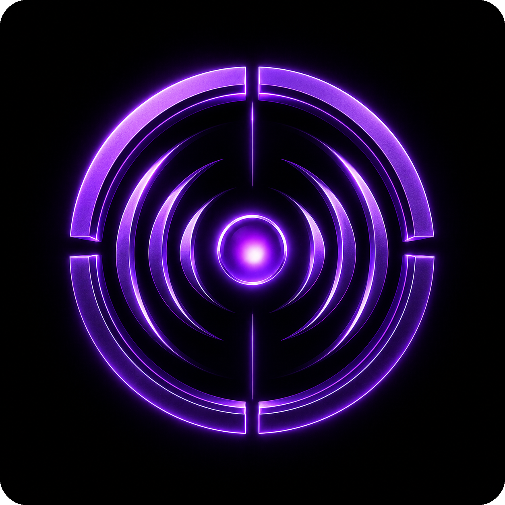
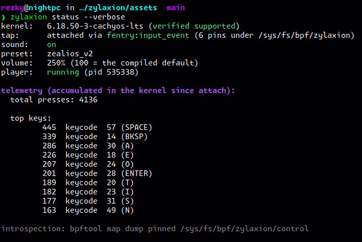

<!-- Copyright (C) 2026 rezky_nightky -->
<!-- SPDX-License-Identifier: GPL-3.0-only -->

<p align="center">
  
</p>

<h1 align="center">zylaxion</h1>

<p align="center">
  <strong>Keyboard sound, computed in the kernel. No samples. No daemon. Just math.</strong>
</p>

<p align="center">
  The first Linux keyboard sound engine built on a passive eBPF input tap:
  fully procedural sound synthesis, zero audio samples, zero daemons, zero
  config files.
</p>

<div align="center">

> Type all you like. Press every key you have.
> The kernel hears every keystroke — and mathematics voices it.
> No sample is ever played, because no sample exists.

</div>

<p align="center">
  <a href="https://ko-fi.com/rezky">
    
  </a>
</p>

## Demo

<!-- Screenshot asset: the rendered help is the real `zylaxion -h` output
     of the v80 build with the brand-styled CLI (purple headings, grey
     grammar tier — night-improve-2). The help surface touches no audio
     or input hardware, so a capture host renders it byte-identical to
     a desktop. A typing-sound video demo needs real audio hardware, so
     it follows at the next owner-host capture session. -->

<p align="center">
  
</p>

## Why zylaxion?

Every other keyboard sound tool is a player — it loads a sample, reads a
config, and runs a process while you type. zylaxion is a computer: a
passive probe on the kernel's own input path, a mathematical engine that
voices what the kernel already heard, and nothing else resident.

zylaxion does not replay anything. Every keystroke that reaches the
kernel is synthesized in real time — noise excitation, TPT State Variable
Filters, resonance modeling, exponential decay — and the input half of
the engine lives inside the kernel as a passive eBPF probe. No /dev/input.
No evdev grab. No udev rules. No input group. No daemon. No config file.
The state store is a handful of pinned BPF maps; the player process is
born on `on` and dies on `off`. What stays resident between keystrokes is
one passive kernel program — and the mathematics it carries.

That mathematics is the Zactrix Engine, measured preset by preset in
[docs/ZACTRIX_AUDIT.md](docs/ZACTRIX_AUDIT.md). Its three filter stages
carry a time-variant spectral envelope — cutoff and Q follow
physics-derived curves, so the spectrum evolves with the actuation
instead of standing still under an envelope.

### What makes zylaxion sharp

Every claim below maps to a mechanism that verifies it — the headless
probes run in the claims battery
([Test Results](#test-results) has the one-command table), and the
doctor's verdicts come from the binary itself.

| Edge | Detail |
|------|--------|
| **Pure math synthesis** | Zero audio samples, zero wavetables, zero decoders. The binary links no audio decoder at all — the process physically cannot play a sample (the claims battery's ELF `DT_NEEDED` sweep proves it, not the marketing). The entire sound engine is mathematical computation. |
| **Kernel-side eBPF tap** | A passive probe on the kernel's own `input_event()` path, attached through a three-step chain the loader walks alone (fentry when vmlinux BTF is present, then kprobe, then the alternate symbol). No device grab, no interference with libinput or the compositor — hotplug, suspend/resume, and other input consumers are untouched by construction. |
| **Zero daemons** | No PID file, no Unix socket, no flock, no IPC protocol, no supervision. The state store is pinned BPF maps on bpffs; `sudo zylaxion attach` once per boot, then every verb is unprivileged and instant. The claims battery sweeps the binary for daemon-era strings and the lockfile for daemon-era crates — zero hits, guarded as a regression test. |
| **No config file** | The Unix configuration surface itself: `--preset` on the CLI, `ZYLAXION_PRESET` in the environment, the compiled default underneath. A file format, a parser, and a background poller are absurd weight for switching between 24 sounds (night-improve-22 deleted the whole config stack). |
| **24 presets compiled in** | Filter frequencies, resonance Q, decay coefficients, spring mix: type-checked Rust data baked into the binary. Zero parse errors possible, zero I/O at startup. |
| **Micro-randomized** | Every keypress gets a unique noise seed, ±1.5% pitch drift, ±5% amplitude drift, ±3% stereo pan jitter, and inter-keystroke timing variation. The same key never sounds identical twice — just like a real physical keyboard. |
| **Sample-rate honest** | Every decay envelope is renormalized to the output device's rate with the `c^(R/S)` law anchored at the 44.1 kHz authoring reference — the same preset rings the same length at 44.1, 48, and 96 kHz. The headless render audit measured 0.0% tail spread across all 24 presets (night-master-4; before the fix it was 54.1%). |
| **Low latency, zero idle cost** | Interrupt-driven ring buffer rendering through cpal: typical latency under 3 ms, and the player's epoll loop costs nothing between keystrokes. |
| **Stateless player** | The player process is born on `on`, reads every byte of state from the pinned maps, and self-exits on `off` — zero processes remain. What stays resident is the kernel side only: one passive BPF program plus pinned maps, ~1-2 µs per keystroke. |
| **Kernel-side typing telemetry** | The tap accumulates per-key counters in the kernel at zero userspace cost; `zylaxion status --verbose` renders them. A feature no userspace sound tool can offer for free. |
| **Strict dependency diet** | 11 direct dependencies, 150 lockfile crates, features trimmed to what is used (env_logger's timestamp and regex feature trees are gone — the build stamp is computed in `build.rs` via Hinnant's civil_from_days, so no time crate rides the tree; night-security-1 audited the rest gate-by-gate — signal-hook's channel/iterator modules and nix's redundant process key are trimmed too). |
| **Zero-leakage posture** | Hardware scancodes drive a pan position and a sound class — never letters. Not logged, not stored as sequences, not transmitted. The audit greps are in [Security & Privacy](#security--privacy). |

### Dependency policy (supply chain)

Dependencies are attack surface. The daemon deletion (night-improve-23)
removed the entire libinput/udev capture stack from the tree; the
no-config law (night-improve-22) removed the TOML parser and its
watcher; the log-crate trim removed the timestamp and regex feature
trees. The claims battery sweeps the transitive lockfile for daemon-era
crates on every run, and the supply-chain CVE scan lane runs in CI (it
caught and fixed the ringbuf advisory, night-improve-24).
night-security-1 then walked every remaining feature gate against the
audited API surface (signal-hook's channel/iterator modules and nix's
redundant process key went; every surviving gate maps to a call site).
`cargo install zylaxion --locked` verifies the published tarball against
the registry index before extraction.

### vs traditional tools

| Approach | Technology | Audio source | Config file | Resident surface |
|----------|-----------|--------------|-------------|------------------|
| Sample sound boards (mechvibes, rustyvibes, and the class) | userspace app + wav packs | recorded clips replayed | mapping file required | app runs while sound plays |
| evdev grabbers | `/dev/input` grab + `input` group | samples or synth | config | resident, device grabbed |
| **zylaxion** | **eBPF tap + procedural DSP** | **pure math, zero samples** | **none (CLI > env > compiled)** | **nothing resident but the kernel tap** |

\* The class rows describe the published shape of those tools, not
benchmarks of them. zylaxion's rows are its own claims battery's
verdict — reproduce it with one command from
[Test Results](#test-results).

## Quick Start

New here? The [Documentation](#documentation) map is the shelf index;
`zylaxion --help` is the one curated reference surface.

### Requirements

- Linux kernel **5.15+** with BPF available — the full floor story and
  the per-distro layouts: [docs/KERNEL_COMPATIBILITY.md](docs/KERNEL_COMPATIBILITY.md).
  Unsure about your kernel? `zylaxion doctor` says yes or no with the
  exact reason — "verified supported" / "verified unsupported" — and
  names the eBPF lane the binary was built with.
- Audio through PipeWire / PulseAudio / ALSA (whatever the desktop
  already runs — cpal talks to the OS's default audio bridge).
- Root **once per boot** for `sudo zylaxion attach`; every other verb
  is unprivileged (the attach hands the pins to your user).

### Install from a release (recommended)

Pre-built binaries are attached to each [GitHub release](https://github.com/oxyzenQ/zylaxion/releases).
No toolchain, no clang, no cargo on the target machine — the pure-Rust
eBPF objects are embedded in the single binary:

```bash
# Resolve the latest release tag — a plain HTTP redirect, no API, no jq:
TAG=$(curl -fsSLI -o /dev/null -w '%{url_effective}' \
      https://github.com/oxyzenQ/zylaxion/releases/latest | sed 's|.*/tag/||')
echo "latest release: ${TAG}"

# The v80-line shape ships two arch-baseline tarballs per tag.
# v3 when in doubt (every CPU that runs v4 runs v3); the legacy
# v11-line tags carried one un-suffixed tarball — the fallback
# covers both, so this block works on either line:
ASSET="zylaxion-${TAG}-linux-amd64-v3-gnu.tar.gz"
curl -fsSfLO "https://github.com/oxyzenQ/zylaxion/releases/download/${TAG}/${ASSET}" ||
  { ASSET="zylaxion-${TAG}-linux-amd64-gnu.tar.gz"; \
    curl -fsSLO "https://github.com/oxyzenQ/zylaxion/releases/download/${TAG}/${ASSET}"; }

# The archive carries zylaxion + LICENSE + README.md — flat on the
# v80 line, under one directory on legacy tags; this lands the
# binary either way:
mkdir zylaxion-pkg && tar xzf "${ASSET}" -C zylaxion-pkg
sudo install -Dm755 "$(find zylaxion-pkg -type f -name zylaxion | head -1)" /usr/bin/zylaxion
```

Verify the download against its checksums before running — the
[Release Verification](#release-verification) section and
[docs/VERIFY_RELEASE.md](docs/VERIFY_RELEASE.md) hold the walkthrough.

Releases are arch-baseline builds: every v80-line package is
x86-64-v3 (AVX2/FMA/BMI — any x86_64 CPU from ~2013 Haswell onward)
or x86-64-v4 (AVX-512), both dynamically linked against glibc — two
tarballs per tag, `zylaxion-v<version>-linux-amd64-v3-gnu.tar.gz`
and `-v4-gnu`, each stamped with its platform id in the binary's
`Build:` line (self-report via `zylaxion -V`). Pick v3 when in
doubt: every CPU that runs v4 runs v3. Not sure what your CPU
takes? `grep -o 'avx512f' /proc/cpuinfo` answers v4 eligibility —
any hit means yes.

The musl lane is documented dormant. zylaxion's audio path runs
through cpal, whose Linux backend is ALSA (libasound.so — a C
library). No musl-compatible static libasound.a ships with any
mainstream distribution, and building one is a maintenance burden
disproportionate to the value: the glibc static-shape releases
already cover the 99% of Linux desktops whose libc is glibc. The
lane wakes when (a) cpal gains a pure-Rust backend, (b) PipeWire
gains a pure-Rust native binding, or (c) ALSA ships a musl static
archive. Until then: dormant, documented, honest. Not coming soon.
Not under development. Waiting on the ecosystem, which is not
zylaxion's to change. (The build-matrix evidence lives in the
release workflow's matrix header.)

### Install from crates.io

`cargo install zylaxion --locked` builds from the published source
tarball and lands the **full-featured binary** — the eBPF tap embedded
— on a plain **stable toolchain: no nightly, no bpf-linker, no
bootstrap** ever touches the installing machine. The detached `ebpf/`
workspace cannot ride a registry tarball, so the crate ships
**`ebpf-prebuilt/`** instead: the maintainer-built kernel object —
with its provenance (`source-tree hash, toolchain, linker, sha256`)
in `ebpf-prebuilt/manifest.toml` — which `build.rs` stages for the
default `ebpf` feature. The lane enforces itself: the commit-time
parity gate (`scripts/gates/check-prebuilt-parity.sh`, wired through
`.githooks/pre-commit` — `gate-keepers.sh` self-installs the hook)
fails any commit whose `ebpf/` tree no longer matches the manifest
pin until `scripts/dev/regenerate-ebpf-prebuilt.sh` refreshes it.
`zylaxion doctor` names the lane
(`registry-prebuilt`). The dormant lane (stable binary, eBPF surfaces
disabled) survives as the explicit opt-out: `--no-default-features`.

### One command on this machine

Building from source on your own box? One command detects the CPU's
x86-64 microarchitecture level, builds the matching shape through the
parity-checked cargo aliases, and installs the binary plus the boot
oneshot:

```bash
git clone https://github.com/oxyzenQ/zylaxion.git
cd zylaxion
./scripts/package/install-on-my-machine.sh
```

The fast lane picks x86-64-v4 when the full AVX-512 set is present,
x86-64-v3 for the AVX2/FMA/BMI class, and the baseline otherwise — so
the installed binary is the same optimization tier the release
pipeline ships. It installs to `/usr/bin/zylaxion` and the **boot
oneshot** (`/etc/systemd/system/zylaxion-attach.service`) that plants
the kernel-side tap at every boot. It is a `Type=oneshot` unit, **not
a daemon**: it runs `zylaxion attach`, exits, and stays dead — what
remains resident is the kernel side only (one passive BPF program plus
pinned maps, zero processes).

### Install from source (manual)

Building needs the pinned Rust toolchain (rustup installs the exact
version from `rust-toolchain.toml`), `pkg-config`, `libasound2-dev`
(only the ALSA headers cpal links against — the libinput/libudev
headers died with the daemon), and — because the `ebpf` feature is
default on every git checkout and source-builds the kernel object —
the dated nightly pin + bpf-linker. One command readies the whole
host: the prerequisites, the PATH fix, and nothing else touched:

```bash
git clone https://github.com/oxyzenQ/zylaxion.git
cd zylaxion

# One-time host setup, COMPLETE: the dated nightly pin from
# ebpf/rust-toolchain.toml + the bpf-linker prebuilt into
# ~/.local/bin (no sudo, no system LLVM) + the PATH fix persisted:
./scripts/dev/bootstrap-ebpf.sh

# The first ./scripts/gate-keepers.sh run also self-installs the
# pre-commit hook (core.hooksPath=.githooks): every commit then runs
# the prebuilt parity gate automatically — edit ebpf/ and the gate
# names the exact refresh command before a stale lane can ship.

# Build:
cargo build --release --locked
# or the exact CI release shape (matches the release workflow verbatim):
cargo pro-linux-amd64-gnu
# or the host-native shape (tuned to this machine's CPU):
cargo pro-native-gnu
```

The portable package lane builds the plain baseline shape and lands
the same system destinations — no CPU tuning, no flags:

```bash
./scripts/package/install.sh
```

> **Note:** no `input` group, no udev rules — the tap is a passive
> kernel-side probe, and the attach hands the pins to your user so
> every other verb stays unprivileged.

### Uninstall

```bash
./scripts/package/uninstall.sh
```

The release payload is one file (plus, for the installer lane, the
oneshot unit) — `sudo zylaxion detach` unpins the kernel side, and
there is nothing else to clean. No `/usr/lib` payload, no user
service, no man page, no cache directory.

### Usage

Every verb, once — flags live in `zylaxion --help`, the deep truth in
`zylaxion status`:

```bash
sudo zylaxion attach             # Plant the kernel-side tap (once per boot)
zylaxion on                      # Sound on (spawns the stateless player)
zylaxion on --preset cherryMX    # Sound on with a compiled-registry preset
zylaxion preset --switch topre   # Switch the preset live while playing
zylaxion volume --percent 60     # Retune the master volume live
zylaxion off                     # Sound off (player self-exits, zero processes)
zylaxion status                  # Kernel verdict, tap residency, player state
zylaxion status --verbose        # + kernel-side typing telemetry (static, print once)
sudo zylaxion detach             # Unpin everything — nothing left in the kernel
zylaxion                         # Quick status overview
zylaxion doctor                  # System health diagnostic (kernel verdict included)
zylaxion list-presets            # List the 24 compiled presets + active one
zylaxion list-backends           # Show available audio backends
zylaxion --check-update          # Check for latest GitHub release
zylaxion -V                      # Show version + build info
```

A verb that cannot be honored is a hard error — red `error:` block,
exit 1, with a did-you-mean tip for a typo'd preset name. There is no
silent fallback: an unknown preset never quietly resolves to the
default, and an invalid volume is a refusal, not a clamp.

The hidden and advanced vocabulary — the short aliases (`-s`, `-p`,
`-v`), the environment surface (`ZYLAXION_PRESET`, `ZYLAXION_VOLUME`,
`NO_COLOR`, `RUST_LOG`), and the internal `_play` verb — is
documented completely in the Pro mode section of `zylaxion --help`,
the one reference surface.

### Configuration

There is no configuration file — night-improve-22 deleted
`config.toml` and its whole support stack (search paths, TOML
parsing, the mtime watcher, the `testconf` validator). The owner's
verdict: a file format, a parser, and a background poller are absurd
maintenance weight for switching between 24 sounds. The masterclass
replacement is the Unix configuration surface itself:

1. `--preset <name>` on the CLI (highest priority)
2. `ZYLAXION_PRESET=<name>` in the environment (persistent selection —
   shell profile, systemd `Environment=`, wrapper script)
3. the compiled default preset (`technical`) if neither names one

The master output volume follows the same law:
`ZYLAXION_VOLUME=1.5` (headphones) overrides the compiled
laptop-speaker default of 5.5. An invalid value is a hard error —
there is no silent fallback, and an unknown preset name prints the
full catalog plus a did-you-mean tip.

A preset is chosen when the sound starts; while playing, switch it
live with `zylaxion preset --switch <name>` (one map write — the
player's watcher thread swaps the DSP model in place). For a sound
switcher that is the honest lifecycle — there is nothing to
hot-reload.

### Built-in sound presets

zylaxion ships **24 presets** — 6 "character" presets, 3 switch-type
presets, 10 high-fidelity legendary keyboard profiles tuned to mimic
real switches, and 5 sci-fi / futuristic presets that don't mimic
anything real. Every preset rides the same 3-layer DSP engine (click
transient + spring resonance + housing "thock") and the same
micro-randomization law.

#### Character presets (general use)

| Preset    | Description                                      |
|-----------|--------------------------------------------------|
| technical | Crisp, loud, punchy. Cherry MX Blue click style. **Compiled default.** |
| cherryMX  | Balanced reference. General MX Blue/Brown.       |
| classic   | Deeper, resonant. Warm bucklespring tone.        |
| studio    | Softer attack, longer decay. Office-friendly.     |
| elegant   | Very soft, muffled. Low-profile keyboards.       |
| whisper   | Extremely quiet, short decay. Libraries/meetings. |

Plus three switch-type presets: `linear`, `tactile`, `clicky`.

#### Legendary keyboard profiles

Each of the following presets was hand-tuned against reference
recordings of the actual hardware. The DSP parameters (click
frequency, resonance Q, decay coefficient, ambient rattle) are
adjusted to capture the signature character of each switch.

| Preset             | Switch Type         | Character                                              |
|--------------------|---------------------|--------------------------------------------------------|
| `ibm_model_m`      | Buckling spring     | Deep, very resonant, long ring. The showcase legend. |
| `topre`            | Electrocapacitive   | Deep "thock", smooth, low resonance. Realforce/HHKB.  |
| `cherry_mx_black`  | Linear (heavy)      | Smooth thud, faint spring ping. ~80g actuation.       |
| `cherry_mx_clear`  | Tactile (heavy)     | Pronounced bump, louder than Brown. ~65g actuation.   |
| `cherry_mx_silver` | Linear (low-pro)    | Fast, snappy bottom-out. Designed for gaming.         |
| `buckling_spring`  | Buckling spring     | Sharper & brighter than Model M. Think Model F.       |
| `alps_skcm`        | Tactile (vintage)   | Complicated ALPS — loud, hollow housing ring.         |
| `gateron_yellow`   | Linear (thocky)     | Lubed linear with PBT caps. Deep, rounded thock.      |
| `zealios_v2`       | Tactile (sharp)     | Almost clicky-feeling bump. Enthusiast tactile.       |
| `rotary_encoder`   | Encoder detent      | Not a keyboard — a smooth metallic knob click.        |

#### Sci-Fi / Futuristic presets

These five presets are completely original acoustic signatures —
they don't mimic real keyboards. Each pushes the DSP parameter
ranges to extremes for cyberpunk aesthetic, gaming immersion, or
just fun — a typing experience no human has heard before.

| Preset             | Character                                                  |
|--------------------|------------------------------------------------------------|
| `cyber_deck`       | High-pitched metallic pings. Hollywood "future terminal".  |
| `oceanic`          | Deep underwater rumble, long bass sustain, muffled thud.   |
| `glass_tactile`    | Tapping a crystal wine glass — pure ringing tone.          |
| `retro_typewriter` | Sharp typebar strike + cast-iron frame ring (no bell).     |
| `neon_pulse`       | Cyberpunk UI button — heavy granular texture on a click.   |

Try them all:

```bash
zylaxion list-presets
zylaxion on --preset ibm_model_m
zylaxion on --preset topre
zylaxion on --preset alps_skcm
zylaxion on --preset glass_tactile
zylaxion on --preset neon_pulse
```

The Zactrix Engine that voices all 24 presets is LTS-frozen (the
certification and its six proofs live in
[docs/ZACTRIX_LTS.md](docs/ZACTRIX_LTS.md), the full security audit
in [docs/ZACTRIX_SECURITY.md](docs/ZACTRIX_SECURITY.md)): the engine
changes only for a security fix, a compatibility fix, or a
measurable improvement proven by the audit harness
(`scripts/audit/zactrix-*.sh`).

## Limitations (honest)

zylaxion is deliberately small and stateless. In one breath:

- **Root once per boot** — `sudo zylaxion attach` plants the tap;
  everything after that is unprivileged, but the attach itself is the
  one privileged surface (a kernel probe is not a userspace toy).
- **Kernel 5.15+ with BPF available** — lockdown / integrity modes
  that block BPF are refused with the exact reason; `zylaxion doctor`
  names the block instead of guessing.
- **The kernel's own unprivileged-bpf gate** — distros that build
  `CONFIG_BPF_UNPRIV_DEFAULT_OFF=y` in (Ubuntu does, 5.15 and 7.0
  verified) boot with `kernel.unprivileged_bpf_disabled=2`, locked for
  the whole boot: the attach handover still plants user-owned pins,
  but every map op a plain user issues is refused, so the control
  verbs (`on`, `preset`, `volume`, `off`, `status`'s live read) cannot
  run as that user on those kernels. The verbs refuse classified and
  `zylaxion doctor` carries the posture line; root keeps its full
  read (the gate keys on capability, not the sysctl).
- **Audio rides the desktop's bridge** — cpal → PipeWire / PulseAudio
  / ALSA. There is no direct JACK backend and no network audio.
- **The musl lane is dormant** — a fully static build waits on a
  static answer for the alsa C library; the reason and the unlock
  paths are written out in the Install section, the build-matrix
  evidence lives in the release workflow's matrix header.
- **A keystroke is a scancode, never a letter** — sound class and
  stereo pan come from key position; layout awareness (QWERTY vs
  Dvorak, what a key *types*) is out of scope by design — it is the
  zero-leakage posture's first wall.
- **One engine for every keyboard** — the kernel tap sees
  `input_event()`, not devices, so two plugged-in keyboards sound the
  same. Per-device voices would need device identity in the kernel
  path, a surface the passive tap deliberately does not touch.
- **CI has no ears** — runners carry no audio and no input hardware.
  The batteries prove the headless surfaces and the micro-VM's
  uinput → snd-dummy chain; a human's ears on real hardware stay the
  owner's verification (the demo video follows at the next
  owner-host capture session).

### The nightly eBPF toolchain (honest)

The eBPF build dependencies (`aya-ebpf` on a pinned nightly rustc,
plus bpf-linker) are experimental — but they are quarantined at
BUILD time. The BPF object is cross-compiled, validated, and embedded
inside the single release binary, so a deployment needs only a kernel
and the one file: no rustup, no nightly, no LLVM. The crates.io lane
ships the maintainer-built object instead (`ebpf-prebuilt/`, with its
provenance manifest), so even a stable-toolchain `cargo install`
lands the full-featured binary. Production stability rests on the
kernel's eBPF UAPI, the most stable ABI Linux maintains — not on the
Rust nightly train.

## Security & Privacy

zylaxion is designed with a **zero-leakage** posture. The short
version: **your keystrokes never leave the process.** The full
design philosophy behind that posture — "the boring and stealth" —
is codified in [docs/PHILOSOPHY.md](docs/PHILOSOPHY.md).

### What zylaxion reads

- **Hardware scancodes** — the physical key location on the keyboard
  (e.g. scancode `30` is the home row key under QWERTY's left hand).
  This is *not* an ASCII character. zylaxion does not translate
  scancodes into letters, symbols, or text. It feeds them straight
  into the DSP engine to choose a stereo pan position and trigger a
  click sound.
- The kernel's input core via a passive eBPF probe on the kernel's
  `input_event()` function — the same key events the kernel itself
  dispatches, observed passively (night-improve-23).

### What zylaxion does NOT do

- **Does not log scancodes** — not at `info`, not at `debug`, not at
  `trace`. The `KeyEvent` struct exists to drive the DSP engine, not
  for human inspection. Audit the codebase: `grep -r 'scancode'
  src/ | grep -E 'log::|println!|eprintln!'` returns zero hits in
  production paths; the one render that names keycodes at all is the
  `status --verbose` telemetry section, which prints the aggregate
  per-keycode counters from the stats map, never event sequences.
- **Does not store keystrokes** — there is no on-disk log, no
  history file, no analytics. Nothing is written to any filesystem:
  the state store is pinned BPF maps on bpffs, and the per-key press
  counters in the stats map are aggregate counts (which keycode, how
  many times), never sequences — a frequency histogram cannot be
  replayed into typed text.
- **Does not transmit keystrokes** — no telemetry, no analytics, no
  crash reports. The only outbound network call is the explicit
  `zylaxion --check-update` subcommand, which fetches the latest
  GitHub release tag and exits. No background phone-home. Under
  root (`sudo`, `su`, a root shell) that check refuses with a
  "do not use sudo" error before any network I/O, and `zylaxion on`
  and the player refuse root the same way — the `on` door closes
  before any path resolution or spawn, and a root player would open
  audio in root's session, which no user desktop shares. `zylaxion doctor`
  warns when run as root because its verdicts describe root's
  session, not yours.
- **Does not accept inbound network connections** — there is no TCP
  listener, no HTTP server, no Unix socket, no IPC protocol. The
  control plane is pinned BPF maps on bpffs: the only writers are the
  attach process (root, once) and your own user's CLI verbs
  (bpffs file permissions govern access — the attach hands the pins
  to your user, so other users cannot touch your sound).

### Why this matters

A naive "acoustic keyboard" implementation that logged scancodes for
debugging would be a side-channel leak: malware with read access to
the process logs could reconstruct typed passwords by mapping
scancodes back through the user's keyboard layout (QWERTY,
Dvorak, etc.). zylaxion's zero-trust logging policy eliminates this
attack surface — there is nothing in the logs to reconstruct.

### Verifying the policy yourself

```bash
# Should print zero matches in production paths (the examples/
# targets only synthesize fixed scancodes for audio sanity runs —
# they render sound, they never dump key events):
grep -rn 'scancode' src/ examples/ --include='*.rs' | \
    grep -E 'log::|println!|eprintln!' | \
    grep -v 'examples/'

# Introspect the entire control plane with stock kernel tooling:
bpftool map dump pinned /sys/fs/bpf/zylaxion/control
# The kernel IS the config, the config IS introspectable.
```

## Architecture

The daemonless control plane (night-improve-23) — the kernel owns the
state, the tap is passive, the player is disposable:

```
                 KERNEL (resident, ~1-2us per keystroke)
 ┌────────────────────────────────────────────────────────────┐
 │  eBPF tap: fentry/kprobe input_event() (the ears)          │
 │    │  filter: EV_KEY, press/release, mapped keys only,     │
 │    │  enabled gate, per-key stats (BPF_ATOMIC fetch-add)   │
 │    ▼                                                       │
 │  pinned maps on /sys/fs/bpf/zylaxion/ (the brain):         │
 │    control (enabled, preset, volume, player pid)           │
 │    keymap  (keycode -> sound class)                        │
 │    events  (ring buffer)      stats (per-key counters)     │
 └────────────────────────────┬───────────────────────────────┘
                              │ epoll (zero idle CPU)
                              ▼
                 PLAYER (alive only while sound plays)
 ┌────────────────────────────────────────────────────────────┐
 │  zylaxion _play — stateless, owns nothing (the mouth):     │
 │  drain ring buffer -> core Orchestrator -> VoicePool ->    │
 │  ringbuf -> cpal callback -> PipeWire/ALSA -> speakers     │
 └────────────────────────────────────────────────────────────┘

 CLI (lives < 5 ms, then exits):
   zylaxion on | off | preset | volume | status  -> map writes/reads
   sudo zylaxion attach | detach                 -> plant / remove
```

## Philosophy

**The boring and stealth.**

zylaxion is a Linux utility that stays out of the user's way while
doing serious work underneath: it plants a passive kernel probe, it
synthesizes sound from mathematics, and it owns nothing — no files
written, no state hoarded, no processes left behind. The interface
rarely changes. Features don't explode. Every release makes it
slightly more stable, slightly faster, slightly easier to maintain.

### What zylaxion IS

- **Single CLI binary** — no daemon, no resident service, no config file
- **Pure math synthesis** — no audio samples, no wavetables, no decoders
- **Pure eBPF input** — no `/dev/input`, no evdev grab, no udev rules
- **Small codebase** — 11 direct dependencies, 150 lockfile crates, easy to audit
- **Predictable behavior** — same input → same sound, every time (with
  the designed micro-randomization on top)
- **Linux-only at runtime** — the `ebpf` feature is a no-op elsewhere;
  BSD/macOS and Windows are out of scope, ever

### What zylaxion will NEVER be

- No sample packs, no downloadable sound fonts, no assets to load
- No daemon mode, no background supervision
- No `config.toml`, no dotfile, no registry of any kind
- No keystroke logging, telemetry, or analytics
- No REST API, no network control plane
- No non-Linux support

### Stable API (from v80.0.0)

The CLI surface is frozen. No breaking changes to commands, flags, or
output format. Future releases focus on:

- Bug fixes
- Kernel and desktop-stack compatibility updates
- Performance improvements (internal, no API changes)

### Release channels

Stable releases are tagged `vX.Y.Z`. Pre-release builds are restricted
to five channels — `dev`, `nightly`, `alpha`, `beta`, `rc` (e.g.
`v1.0.0-dev.1`, `v1.0.0-rc.1`). CI rejects any other suffix and never
marks a pre-release as "latest".

### Branches

| Branch | Purpose | Status |
|--------|---------|--------|
| `main` | Pure math synthesis + the kernel-side eBPF tap | active |

## Contributing

PRs and issues are welcome. The bar is the gate suite — build, test,
conventions, and the script inventory are documented once in
[CONTRIBUTING.md](CONTRIBUTING.md); project conventions also live in
[docs/RULES.md](docs/RULES.md). Contributions land under the
[Contributor License Agreement](CLA.md) — the dual-license offer needs
the relicensing grant, and the DCO-style `Signed-off-by:` line on your
commits (`git commit -s`) is the acceptance; no separate signature.

## Security Policy

zylaxion runs a kernel probe and voices every keystroke on the machine,
so security is part of the product. Found something? **Report it
privately** — the policy, supported versions, and what counts as a
vulnerability live in [SECURITY.md](SECURITY.md); the zero-leakage
design record is [Security & Privacy](#security--privacy) above.

## Documentation

- [Documentation Map](docs/README.md) — every document in the tree,
  one row per question (the master index)
- [Philosophy](docs/PHILOSOPHY.md) — "the boring and stealth", the
  design posture behind the zero-leakage engine
- [The eBPF-only bet](docs/EBPF_ONLY_VS_DAEMON.md) — the honest
  pros-and-cons ledger of the daemon deletion: wins with their
  verifiers, costs with their irreducible remainders
- [Kernel Compatibility](docs/KERNEL_COMPATIBILITY.md) — the 5.15
  floor, BTF/lockdown behavior, per-distro layouts
- [Release Verification](docs/VERIFY_RELEASE.md) — checksum + GPG
  walkthrough, told once there
- [Glossary](docs/GLOSSARY.md) — the project's vocabulary (Dragon
  Guard, gate-keepers, the 600-line law)
- [Rules](docs/RULES.md) — the enforced conventions (naming, headers,
  CI lanes, branding)
- [Branding](docs/BRANDING.md) and [Maintenance
  playbook](docs/MAINTENANCE.md) — the brand record, the owner's
  upkeep routines
- [Contributing Guide](CONTRIBUTING.md) — gates, conventions, the
  script inventory
- [Contributor License Agreement](CLA.md) — the CLA terms and the DCO
  sign-off acceptance
- [Security Policy](SECURITY.md) — private reporting, scope, supported
  versions
- [Q&A Record](QA.md) — owner questions answered against the source
- [Commercial License](COMMERCIAL_LICENSE.md) — tiers, payment,
  verification
- [Trademark](TRADEMARK.md) — the Marks and the forking policy
- [Changelog](CHANGELOG.md) — the notable-changes record

## Test Results

Every harness below is one command. The battery runs headless where
the claim allows it, and the micro-VM legs prove the rest inside a
real kernel. The full-chaos engine and its ledger live in
`scripts/supermassive/`:

| Harness | What it proves | One command |
|---------|----------------|-------------|
| [supermassive rootless self-test](scripts/supermassive/supermassive-test.sh) | The env probes, the CLI/UX battery, and the world-first static claims — no root, no hardware needed | `./scripts/supermassive/supermassive-test.sh --self-test` |
| [supermassive full battery](scripts/supermassive/supermassive-test.sh) | The whole chaos: the tap lifecycle (attach, pin handover, idempotency, foreign entries, detach), a real user with no `input` group typing through uinput, the kernel-side telemetry, the PCM witness, live preset/volume map writes | `sudo ./scripts/supermassive/supermassive-test.sh --full` |
| KVM micro-VM E2E (CI) | The zero-to-hero chain inside a real kernel, two legs: the documented 5.15 floor and the newest kernel the archive serves — verdicts relayed as `MASS-RESULT` / `MASS-VERDICT` rows on the serial console | `.github/workflows/supermassive.yml`, on every push touching the code surface |
| [the workspace test tree](scripts/build.sh) | Unit + doc tests across the crates (175 in the dormant lane alone), plus fmt and clippy | `./scripts/build.sh check-all -q` |
| [the gate suite](scripts/gate-keepers.sh) | Permissions, SPDX headers, LOC caps, language, emoji, action pins, release parity, the name-case rule | `./scripts/gate-keepers.sh` |

### The world-first claims battery

The extraordinary claims get their own independent verification lane
(`scripts/supermassive/sm_static.py` — pure stdlib, no `readelf`, no
`ldd`):

- **Pure math** — a hand-rolled ELF64 `DT_NEEDED` parser proves zero
  audio decoders are linked (a sample physically cannot play), and
  `zylaxion list-presets` is compared byte-for-byte against the
  compiled registry source (24 presets, set equality).
- **eBPF** — the binary is scanned for embedded ELF-BPF objects
  (`e_machine` 247) carrying the `input_event` attach target, and the
  `ebpf-prebuilt/` lane is pinned to its manifest; a dormant build
  gets an honest SKIP, never a fake pass.
- **No daemon, no bloat** — the binary is swept for daemon-era
  strings (`config.toml`, pidfile, socket, libinput, the retired
  restart advice) and the transitive lockfile is swept for daemon-era
  crates: zero hits, and the sweep doubles as the regression guard.

Three facts that shape a run. The `--full` lane is strict — a SKIP
there is an assembly bug, never an acceptable answer, because the
micro-VM's init stages everything the engine needs. The battery is
offline by design — zylaxion needs no network, and a deterministic
guest beats a wired one. And a green Actions run is the same verdict
these commands produce locally: the CI legs run the same engine, the
same canonical invocations, on hosted KVM hardware.

## Release Verification

Each release ships **three** checksums: classical SHA-512 +
quantum-resistant BLAKE3-256 + SHAKE256, and — when the owner's
signing key is configured — a GPG detached signature (`.asc`):

```bash
# Classical (universal)
sha512sum -c zylaxion-vX.Y.Z-linux-amd64-v3-gnu.tar.gz.sha512sum

# Quantum-resistant — BLAKE3 (the official b3sum CLI; older
# releases ship *.b2sum / BLAKE2b instead — verify those with b2sum)
b3sum -c zylaxion-vX.Y.Z-linux-amd64-v3-gnu.tar.gz.b3sum

# Quantum-resistant — SHAKE256 (NIST PQ standard, via Python)
COMPUTED=$(python3 -c "import hashlib; print(hashlib.shake_256(open('zylaxion-vX.Y.Z-linux-amd64-v3-gnu.tar.gz','rb').read()).hexdigest(64))")
EXPECTED=$(awk '{print $1}' zylaxion-vX.Y.Z-linux-amd64-v3-gnu.tar.gz.shake256)
[ "$COMPUTED" = "$EXPECTED" ] && echo "OK" || echo "FAILED"
```

The full walkthrough, the algorithm rationale, and the smoke check
that compares the binary's own `Build:` label against the release tag
live in [docs/VERIFY_RELEASE.md](docs/VERIFY_RELEASE.md), told once
there.

## Support

zylaxion is an open-source project built and maintained independently —
the [Author](#author) section below says who by.

If this project made your keyboard sound the way it always should
have, you can support future maintenance here:

[](https://ko-fi.com/rezky)

### Crypto donations

Owner-verified receive addresses. All three passed offline cryptographic
verification (EIP-55 mixed-case checksum for Ethereum, bech32m
witness-v1 for Taproot, base58-to-32-byte ed25519 key for Solana).
Always double-check the address on screen before sending — network
mismatches (e.g., sending USDT-ERC20 to a Solana address, or sending
BTC to a non-Taproot address) will permanently lose funds.

- **Solana** — `SOL` / `USDT` (SPL) on Solana mainnet: `88umzS7abaToaGQVgTVXt5SnuvcjTw2jPSM6Ha2JYmXM`
- **Ethereum** — `ETH` / `USDT` (ERC-20) / `USDC` (ERC-20) on Ethereum mainnet: `0x1bCbA21c07B5636a942De27AA7Ee8283cEDb4C3D`
- **Bitcoin** — `BTC` on Taproot (P2TR, bech32m, `bc1p`-prefixed — verified Taproot, not native SegWit): `bc1p88nqysn4p8u9zxwz2pyxs5pl77wllcrk6ca2r2l3ryr3863hxkys5vdkze`

The QR codes for all three live in
[COMMERCIAL_LICENSE.md](COMMERCIAL_LICENSE.md#5-payment) — the same
owner-verified addresses. Support is optional. The project remains
open-source.

## Intellectual Property & Trademark

**zylaxion** is the exclusive intellectual property of
**rezky_nightky (oxyzenQ)**.

- Source code: licensed under **GPL-3.0-only** (see [LICENSE](LICENSE)).
- Name, logo, and branding ("the Marks"): governed by
  [TRADEMARK.md](TRADEMARK.md). The Marks are NOT covered by the GPL and
  are reserved by the owner.
- This project is **NOT for sale**. Unauthorized rebranding, relicensing,
  or source-code theft is strictly prohibited.

**Forking policy** (full text in [TRADEMARK.md §4](TRADEMARK.md)):
forks of zylaxion MUST use a different project name, MUST use
different branding (logo, color scheme, and so on), MUST preserve the
GPL-3.0-only license and copyright notice, and MUST clearly state the
fork is derived from zylaxion but is NOT zylaxion and is NOT endorsed
by rezky_nightky (oxyzenQ).

For trademark licensing or written permission, see
[TRADEMARK.md §6](TRADEMARK.md) — the contact channels live there,
told once.

## Commercial Licensing

Companies using zylaxion in production need a commercial license.

zylaxion is dual-licensed: **GPL-3.0-only** for open-source use, and a
**Commercial License** for proprietary and commercial use (SaaS
offerings, internal tools that cannot meet copyleft, redistribution
under your own terms). Full details, payment instructions, and the
verification process live in [COMMERCIAL_LICENSE.md](COMMERCIAL_LICENSE.md);
the short version:

| Tier       | Price          | Target                                              |
| ---------- | -------------- | --------------------------------------------------- |
| Personal   | Free (GPL-3.0) | Hobby, personal, non-commercial, contributions      |
| Individual | $99/year       | Solo devs, freelancers, revenue < $100K/year        |
| Business   | $2,199/year    | Individual businesses and small teams (SMB)         |
| Company    | $9,199/year    | Companies and enterprise, OR redistribution rights  |

The business end of the ladder follows the value upward
(night-improve-17): zylaxion is a masterpiece, and its value increases
year by year — the price tracks the value, and it will keep rising as
the work compounds. Buyers who paid before a move are grandfathered at
the price they bought, for the term they bought.

**Unauthorized use is theft.** Taking this code — stealing it, forking
it illegally, stripping the license, or building a closed-source
commercial product on it — without first contacting the owner
(rezky_nightky / oxyzenQ) and paying the license is, in the owner's own
words, the mark of the worst kind of human — a rotten one. The honest
paths are exactly two: comply with GPL-3.0-only (free, first-class, not
a trial), or buy the tier your revenue honestly matches. There is no
third path that leaves you clean.

Tiers are self-declared in good faith. Payment is USD-pegged crypto
(Solana / Ethereum / Bitcoin, owner-verified addresses with QR codes —
see [COMMERCIAL_LICENSE.md](COMMERCIAL_LICENSE.md)). Licensing contact:
[with.rezky@gmail.com](mailto:with.rezky@gmail.com).

The voluntary [crypto donations](#crypto-donations) above are separate
from commercial licensing — donations support the project; a commercial
license buys rights.

## License

Dual-licensed: **GPL-3.0-only** for open-source use (see
[LICENSE](LICENSE)), or the **Commercial License** for proprietary and
commercial use (see [COMMERCIAL_LICENSE.md](COMMERCIAL_LICENSE.md)).

## Author

**rezky_nightky (oxyzenQ)** — built with curiosity, not pressure.

---

<p align="center">
  <em>No samples. No daemon. No config file. Just math.</em>
</p>

<p align="center">
  <em>built with curiosity &amp; masterpiece</em>
</p>
<!-- ZYLAXION-DISCLAIMER -->
<!--
  Documentation Disclaimer — read before relying on any data point.

  This document may contain stale data, hardcoded counts, or outdated
  file paths and symbol names. Maintainers update source code but may
  forget to sync every doc — perfect sync across every .md file is a
  known maintenance burden with diminishing returns.

  Source code (`src/**/*.rs`, `ebpf/src/**/*.rs`) is the single source of
  truth. Always cross-check against the actual source files before
  relying on any specific number (preset count, latency figure,
  dependency count), file path, function name, or command spelling.

  If you find a discrepancy, please open a PR — the doc is wrong, not
  the source.
-->
